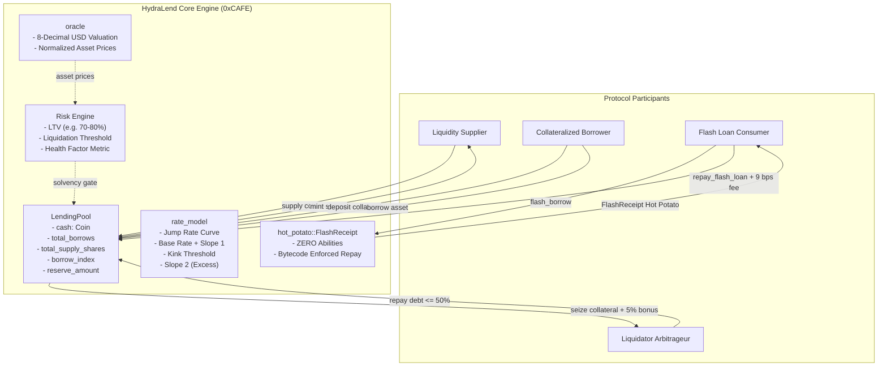

# HydraLend

[](https://aptoslabs.com)
[](https://move-language.github.io/move/)
[](https://github.com/ZengLLQ/hydra-lend)
[](https://opensource.org/licenses/MIT)

**HydraLend** is a multi-asset isolated lending market and flash liquidity protocol implemented in Move on Aptos. It combines linear resource escrow (`Coin<Asset>`), a continuous piecewise-linear **Jump Rate Interest Model**, cross-collateral risk accounting with 8-decimal normalized price oracles, bounded-debt **close factor liquidations**, and uncollateralized **Hot-Potato Flash Loans** verified at the bytecode level.

---

## Architecture Overview

HydraLend is designed around Move's resource-oriented paradigm and linear type safety. Vault assets are escrowed as first-class resources, preventing double-spend vectors and reentrancy exploits natively without runtime mutex reentrancy locks.



---

## Mathematical Formulation

### 1. Utilization Rate ($U$)

The protocol tracks liquidity utilization $U$ to measure borrowing pressure against cash reserves and protocol insurance reserves:

$$U = \frac{\text{borrows}}{\text{cash} + \text{borrows} - \text{reserves}}$$

Where:
- $\text{cash}$: unborrowed liquidity held in the vault (`Coin<Asset>`).
- $\text{borrows}$: total active principal plus accrued interest.
- $\text{reserves}$: protocol-owned insurance cut accumulated from borrow fees.

In HydraLend, $U \in [0, 10000]$ basis points ($0.0\%$ to $100.0\%$).

### 2. Piecewise Linear Jump Rate Model ($R_{\text{borrow}}$)

Interest rates dynamically adjust according to an optimal utilization "kink" point ($U_{\text{kink}} = 80.0\%$):

$$R_{\text{borrow}}(U) = \begin{cases} 
R_{\text{base}} + \left(\frac{U}{U_{\text{kink}}}\right) \cdot R_{\text{slope1}} & \text{if } U \le U_{\text{kink}} \\
R_{\text{base}} + R_{\text{slope1}} + \left(\frac{U - U_{\text{kink}}}{1 - U_{\text{kink}}}\right) \cdot R_{\text{slope2}} & \text{if } U > U_{\text{kink}}
\end{cases}$$

- **Base Rate ($R_{\text{base}}$)**: $2.0\%$ APY at zero utilization.
- **Kink Utilization ($U_{\text{kink}}$)**: $80.0\%$.
- **Slope 1 ($R_{\text{slope1}}$)**: $+8.0\%$ APY at kink ($10.0\%$ total borrow APY).
- **Slope 2 ($R_{\text{slope2}}$)**: $+100.0\%$ APY steep penalty curve disincentivizing complete pool illiquidity.

### 3. Supply Interest Rate ($R_{\text{supply}}$)

Suppliers earn interest based on the active borrower payments minus the protocol reserve factor ($RF = 10\%$):

$$R_{\text{supply}}(U) = R_{\text{borrow}}(U) \cdot U \cdot (1 - RF)$$

### 4. Position Health Factor ($\text{HF}$)

Every borrowing position evaluates its solvency across collateral and debt valuations in normalized 8-decimal USD:

$$\text{Health Factor} = \frac{\sum_{i} \left(V_{\text{collateral}, i} \cdot \text{Threshold}_i\right)}{\sum_{j} V_{\text{debt}, j}}$$

- **Healthy Position**: $\text{HF} \ge 1.0$ ($10,000$ bps).
- **Liquidatable Position**: $\text{HF} < 1.0$ ($< 10,000$ bps).
- **Borrow Ceiling**: New borrows require $\sum V_{\text{debt}} \le \sum (V_{\text{collateral}} \cdot \text{LTV})$.

### 5. Liquidation Mechanics & Close Factor

When $\text{HF} < 1.0$, third-party liquidators can liquidate the position subject to an institutional **Close Factor** ($C_{\text{max}} = 50.0\%$):

$$D_{\text{repay}} \le C_{\text{max}} \cdot D_{\text{total}}$$

The liquidator receives equivalent collateral value plus a liquidation bonus ($B = 5.0\%$):

$$V_{\text{seized}} = V_{\text{repay}} \cdot (1 + B)$$

$$\text{Collateral Seized} = \frac{V_{\text{seized}} \cdot 10^{\text{decimals}_{\text{col}}}}{P_{\text{col}}}$$

---

## The "Hot Potato" Flash Loan Guarantee

Traditional EVM flash loans require external callback interfaces (e.g., `IFlashLoanReceiver.executeOperation`) and runtime reentrancy guards, exposing protocols to state reentrancy and unexpected control-flow hijacks.

HydraLend leverages Move's **Hot Potato Pattern**:

```move
struct FlashReceipt<phantom Asset> {
    pool_address: address,
    borrow_amount: u64,
    fee_amount: u64,
}
```

Because `FlashReceipt` has **no abilities** (no `copy`, no `drop`, no `store`, no `key`):
1. **Cannot be copied**: Prevents artificial duplication of credit receipts.
2. **Cannot be stored**: Cannot be persisted in global storage across transactions.
3. **Cannot be dropped**: The Move bytecode verifier **strictly forbids** discarding the struct at runtime.

The only way the transaction can execute and commit is by passing the `FlashReceipt` into `hydra_lend::lending_market::repay_flash_loan`, which unpacks and burns the receipt while receiving the principal plus a 9 bps protocol fee. If the borrower fails to repay, the transaction fails **compilation / static verification** without needing gas-intensive runtime balance checkpoints.

---

## Modules Directory

| Module | Source | Description |
|---|---|---|
| `hydra_lend::math` | [`sources/math.move`](sources/math.move) | WAD/RAY fixed-point scaling, basis points conversions, and linear interpolation |
| `hydra_lend::rate_model` | [`sources/rate_model.move`](sources/rate_model.move) | Utilization tracking and 2-slope Jump Rate calculation for borrowing & supply APY |
| `hydra_lend::oracle` | [`sources/oracle.move`](sources/oracle.move) | 8-decimal USD price feed registry with token decimal conversion engines |
| `hydra_lend::hot_potato` | [`sources/hot_potato.move`](sources/hot_potato.move) | Ability-free `FlashReceipt` struct enforcing flash loan atomic round-trip |
| `hydra_lend::lending_market` | [`sources/lending_market.move`](sources/lending_market.move) | Core market logic: deposits, shares, collateral, borrow, repay, liquidate, flash loan |

---

## Automated Test Suite

HydraLend features 14 comprehensive unit, edge-case, and formal invariant tests:

```bash
aptos move test
```

### Verified Test Results

```text
Running Move unit tests
[ PASS    ] 0xcafe::hydra_tests::test_borrow_fails_insufficient_collateral
[ PASS    ] 0xcafe::hydra_tests::test_collateral_deposit_and_borrow
[ PASS    ] 0xcafe::hydra_tests::test_hot_potato_flash_loan_success
[ PASS    ] 0xcafe::hydra_tests::test_hot_potato_insufficient_repay_fails
[ PASS    ] 0xcafe::hydra_tests::test_interest_accrual_over_time
[ PASS    ] 0xcafe::hydra_tests::test_liquidation_fails_exceeding_close_factor
[ PASS    ] 0xcafe::hydra_tests::test_liquidation_fails_if_healthy
[ PASS    ] 0xcafe::hydra_tests::test_liquidation_flow
[ PASS    ] 0xcafe::hydra_tests::test_math_operations
[ PASS    ] 0xcafe::hydra_tests::test_oracle_valuation
[ PASS    ] 0xcafe::hydra_tests::test_rate_model_utilization_and_jump_curve
[ PASS    ] 0xcafe::hydra_tests::test_repay_borrow_debt
[ PASS    ] 0xcafe::hydra_tests::test_solvency_invariant_audit
[ PASS    ] 0xcafe::hydra_tests::test_supply_and_withdraw
Test result: OK. Total tests: 14; passed: 14; failed: 0
```

---

## Solvency Invariant Audit

The protocol maintains a strict balance invariant across all pools:

$$\text{Cash}_{\text{pool}} + \text{Borrows}_{\text{pool}} - \text{Reserves}_{\text{pool}} \equiv \text{Total Supplier Claim}$$

Verified by `test_solvency_invariant_audit`:
- Depositing 50,000 USDC mints 50,000 initial shares.
- Borrowing 20,000 USDC decreases cash to 30,000 USDC while increasing total borrows to 20,000 USDC.
- Net pool value remains exactly 50,000 USDC ($30,000 + 20,000 - 0 = 50,000$).
- Supplier share redemption values are strictly preserved.

---

## Design Trade-Offs & Known Limitations

1. **Discrete Interest Updates**: Interest is compounded lazily on user state transitions (supply, borrow, repay, liquidate, flash loan). While gas-optimal, pools dormant for extensive intervals compute linear interest approximations over the elapsed delta rather than infinitesimal exponential curves.
2. **Close Factor Bound**: The 50% close factor protects borrowers against instant 100% liquidation shocks during temporary price wicks, but requires multi-step liquidations for severely impaired accounts.
3. **Isolated Markets**: Collateral is evaluated per-pair/isolated market. Cross-margin across arbitrarily large baskets of correlated collateral requires cross-asset matrix valuations.

---

## License

This project is licensed under the [MIT License](LICENSE).
